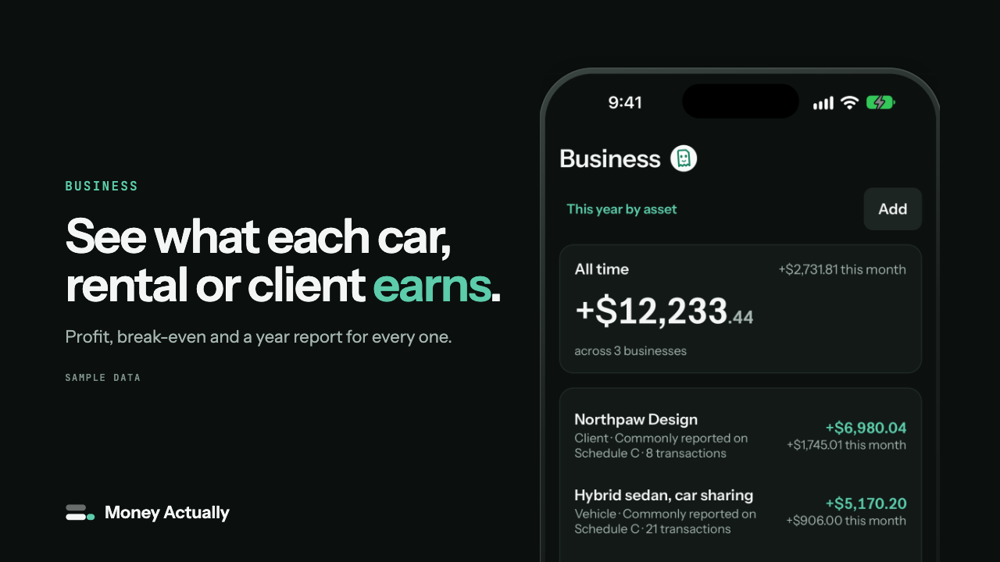

# Money Actually

**Which car, rental or client is actually making you money?**

Money Actually is a read-only personal finance app for US bank accounts, on the web, iPhone and Android. It shows your budget, your net worth, and what each car, rental or client actually earns.

**[Open the demo with sample data](https://moneyactually.app/demo/business?ref=github)**. No signup, no bank link.

## What you see

- **Profit, break-even and a year report for each car, rental or client**, grouped the way Schedule C and E group them. A car on a car-sharing app such as Turo, a rental unit and a freelance client each get their own.
- **Net worth with every debt counted.** The car loan sits next to the car.
- **A budget as one left-to-spend number**, with the bills already paid and the ones still coming, plus subscriptions found in your transactions.

Most money apps flatter you. Money Actually reports, and it says when it cannot verify a number.

## What it can't do

- **Move money.** There is no transfer button anywhere.
- **See your bank password.** Bank sign-in goes through Plaid, so the password never reaches our servers.
- **Send anything to AI unless you ask.** Nothing is sent unless you type a question to Slip, the in-app assistant, and you can turn Slip off.

No ads, no data selling. Data at rest is encrypted with AES-256, with a second AES-256-GCM layer on bank connection keys. You can delete everything from inside the app or on the web. More on the [security page](https://moneyactually.app/security?ref=github).

## Get it

US banks only, through Plaid: up to five banks, with every account at each one. 7-day free trial with no card needed on the web, then $6.99/month, or $59.99/year on the web ([pricing](https://moneyactually.app/pricing?ref=github)).

- [Web app](https://moneyactually.app/?ref=github)
- [iPhone (App Store)](https://apps.apple.com/app/money-actually/id6813643415)
- [Android (Google Play)](https://play.google.com/store/apps/details?id=app.moneyactually.twa)
- [Car-sharing profit calculator](https://moneyactually.app/tools/car-sharing-profit?ref=github): one car, one month, no signup

## About this organization

The app's source code is private. The only public repository here is this profile.

- Questions and bug reports: support@moneyactually.app or the [contact page](https://moneyactually.app/contact?ref=github)
- Security reports: support@moneyactually.app, as listed in [security.txt](https://moneyactually.app/.well-known/security.txt)

Built by Rashed, a solo founder.

[X](https://x.com/MoneyActually_) · [Instagram](https://instagram.com/moneyactuallyapp) · [TikTok](https://tiktok.com/@moneyactuallyapp) · [YouTube](https://youtube.com/@moneyactuallyapp)
